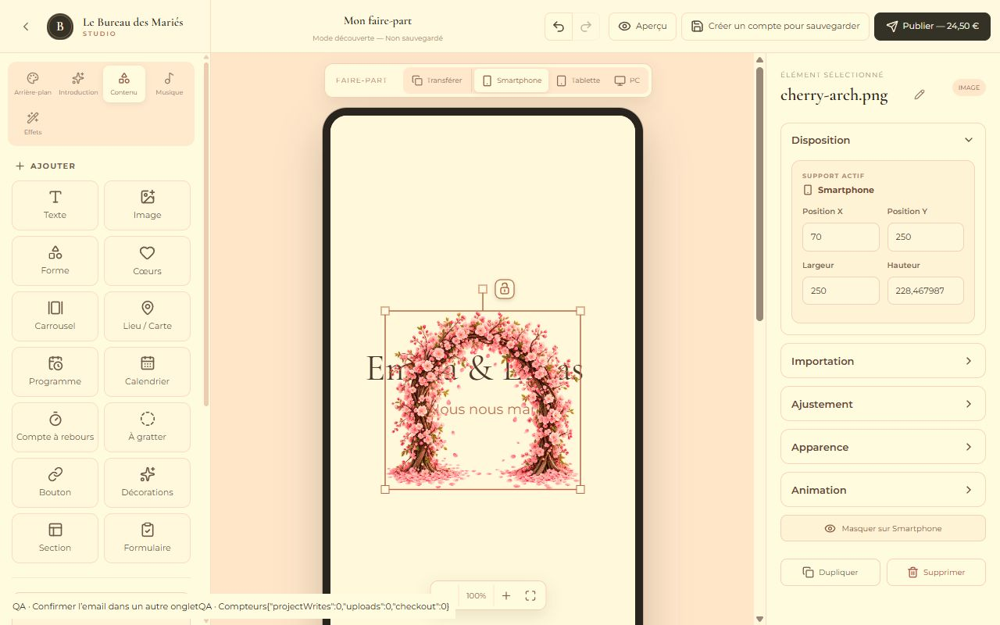

# Mode découverte — validation du 14 octobre 2026

## Parcours

L’accueil `/` et l’éditeur éphémère `/studio/discovery` sont publics. La galerie et les aperçus des modèles publiés sont accessibles depuis l’accueil. Les routes `/studio/:projectId`, réponses RSVP, administration, demandes commerciales et paiements restent protégées. Le routeur utilise le Data Router pour bloquer correctement les navigations internes, y compris le bouton Retour du navigateur.

Un avertissement est affiché une seule fois au démarrage de chaque nouvelle création. Ensuite, seuls le badge « Mode découverte — Non sauvegardé » et le bouton « Créer un compte pour sauvegarder » restent dans la barre. Le bouton reste visible sur Smartphone. En quittant l’éditeur, une confirmation permet de revenir, abandonner ou ouvrir l’inscription intégrée. `beforeunload` demande une confirmation native quand le navigateur le permet, sans garantie absolue sur mobile.

## Mémoire et imports

Le projet demeure dans le store Zustand existant, sans middleware persist. Un store découverte séparé ne contient que l’état de session/boîtes de dialogue ; les `File` et Object URLs sont conservés dans une Map en mémoire. Images, sections, carrousels, décors, polices, musique, introductions et motifs passent par l’uploader existant, qui retourne un asset temporaire en mode découverte sans contacter Supabase. Le chemin IndexedDB de la musique n’est pas utilisé par les invités, même si Supabase n’est pas configuré.

Les sauvegardes automatiques sont suspendues. Les sauvegardes directes locales/distantes et le checkout possèdent des garde-fous supplémentaires. Aucune session Auth anonyme n’est créée. Les fichiers retirés restent en mémoire pour Annuler, puis toutes les Object URLs sont révoquées à l’abandon ou après conversion. Aucune récupération après fermeture/rechargement n’est implémentée.

## Authentification et conversion

La modale réutilise `useAuth.signUp/signIn`, sans quitter l’éditeur. Si une confirmation email est nécessaire, elle explique de garder l’onglet ouvert et de confirmer dans un autre onglet. L’AuthProvider existant reçoit les événements Supabase de session, y compris inter-onglets sur le même site. Aucune sauvegarde n’est annoncée avant une session réelle et la réussite complète du transfert. Une session de récupération de mot de passe ne déclenche pas de conversion.

`persistGuestDraftAfterAuth` valide le brouillon et la session, génère un nouvel ID et retire tous les droits de publication/payants via le sanitizer existant. Le projet appartient au compte et reste draft/unpaid. Le premier INSERT utilise `createOnly` : aucun projet existant ne peut être écrasé. Une promesse partagée empêche les doubles créations ; les reprises réutilisent l’ID et les transferts réussis.

Un parent draft/unpaid sans références temporaires est enregistré après connexion pour satisfaire les règles d’ownership des assets. Si un transfert échoue, ce parent peut donc déjà exister, mais l’éditeur conserve intégralement son brouillon et affiche une erreur, jamais un succès complet. Les fichiers sont ensuite transférés dans `wedding-assets` sous le nouveau compte/projet. Chaque URL et ID temporaire est remplacé avant sauvegarde finale. Les références Blob sont refusées dans les sauvegardes distantes et locales. L’édition est suspendue pendant le transfert ; une évolution concurrente du brouillon exige une reprise, sans perdre la dernière version.

À la réussite : navigation interne vers le nouvel ID, reprise des sauvegardes normales, sélection/support/zoom et historique conservés (ID/propriétaire et références de l’historique également convertis), badge retiré et message de succès. L’indisponibilité du cache local n’annule pas une sauvegarde distante réussie.

## Templates et sécurité

Les invités instancient un snapshot client des modèles publiés, sans appeler le RPC persistant. Les presets et assets globaux publiés restent accessibles. La signature des vidéos sans session est limitée aux chemins `templates/` ; la politique Storage décide toujours si le modèle est publié. Les vidéos de projets privés requièrent une session.

Le guide Supabase a orienté la séparation Auth/recovery, l’absence d’uploads anonymes et le maintien des contrôles de propriété. Les politiques réellement déployées ont été inspectées en lecture seule : lecture des modèles/assets globaux publiés pour anon, projets réservés au propriétaire non anonyme, mutations admin réservées aux administrateurs, vidéos privées protégées. Aucune migration, modification de RLS, paramètre Auth, bucket public ou contournement Stripe n’a été ajouté. Changelog et documentation officielle Auth consultés.

## Tests

505 tests Node passent, dont 10 nouveaux tests découverte : absence de persistance/Stripe invité, imports File/Blob pour images/polices/musique/ouvertures, nettoyage mémoire, confirmation sans session, rejet anonyme/recovery, conversion complète sans droits payants, double clic, échecs et reprises sans doublon, refus d’écrasement, historique après conversion, templates locaux et signature vidéo anonyme limitée.

Vérification navigateur avec services simulés, sans compte/email/paiement réel : accueil public, galerie ne montrant pas le modèle privé, aperçu du modèle Smartphone/Tablette/PC, création à partir d’un modèle et vierge, avertissement unique, renommage, import PNG avec zéro upload/écriture de projet, CTA visible sur viewport Smartphone, ouverture et aperçu Tablette/PC, refus de publication avant compte, message de confirmation email, session simulée suivie d’une conversion sans perte du nom, confirmation de sortie puis retour sans restauration du brouillon. La confirmation email réelle et la diffusion de session inter-onglets devront être validées avec un compte utilisateur sur le domaine de production ; aucun email réel n’a été envoyé.

`npm run build` passe avec Node 22.23.3. Avertissement Vite habituel sur la taille du bundle, sans erreur. `git diff --check` passe. Aucun déploiement de l’application réalisé.

## Fichiers

- Routing/pages : `src/App.tsx`, `src/pages/HomePage.tsx`, `src/pages/EditorPage.tsx`.
- Session/conversion/UI : `src/features/discovery/discoverySession.ts`, `persistGuestDraft.ts`, `DiscoveryDialogs.tsx` ; `src/components/toolbar/TopToolbar.tsx`, `src/styles.css`.
- Persistance : `src/stores/editorStore.ts`, `src/utils/storage.ts`, `src/services/projectRepository.ts`, `assetRepository.ts`, `previewVideoRepository.ts`.
- Imports invités sans stockage durable : `src/components/sidebar/LeftSidebar.tsx`, `src/features/elements/RichElementProperties.tsx`, `src/features/music/MusicPanel.tsx`, `src/features/particles/ParticlePanel.tsx`, `src/features/welcome/WelcomePageEditor.tsx`.
- Tests : `tests/discovery.test.mjs`, `discovery.browser.html`, `discovery.browser.tsx`, `discovery.mock.tsx`, `discovery.vite.mjs`, `tests/auth-recovery.test.mjs` (assertions adaptées au Data Router).
- Documentation/preuve : ce fichier, `docs/discovery-mode-preview.png`.

