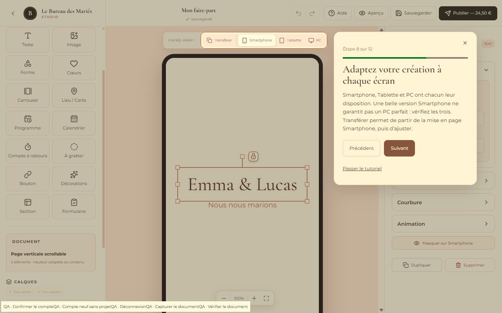

# Visite guidée facultative — 14 octobre 2026

## Expérience

La visite est proposée, jamais lancée automatiquement : **Découvrir le studio**, **Plus tard**, fermeture et Échap. Après refus, elle ne revient pas à chaque navigation. Le bouton **Aide** reste disponible dans l’éditeur sur Smartphone, Tablette et PC, y compris après inscription. Aucune aide n’est ajoutée au faire-part public. L’Aperçu suspend la surcouche jusqu’au retour à l’éditeur.

L’aide ouvre trois entrées : **Refaire la visite guidée**, **Découvrir les fonctionnalités**, **Aide sur l’outil actuel**. Le catalogue explique les principaux outils. Quatre mini-visites sont déjà disponibles (textes/polices, courbure, formats, musique/effets), ainsi qu’une courte aide contextuelle. Le registre permet d’en ajouter sans changer le moteur.

## Visite principale

1. Bienvenue dans votre studio de création.
2. Tous vos outils sont ici : les onglets de création.
3. Personnalisez votre arrière-plan : fond du document et textures des Sections.
4. Créez une ouverture mémorable : Enveloppe, Porte, page d’accueil ou accès direct.
5. Donnez vie à votre faire-part : Contenu et ajouts.
6. Tout est personnalisable : sélection, propriétés, déplacement/redimensionnement.
7. Organisez votre faire-part : Sections, calques, ordre, visibilité et verrouillage.
8. Adaptez votre création à chaque écran : Smartphone, Tablette, PC et Transférer.
9. Animez votre création : effet, durée, apparition initiale et scroll.
10. Créez une ambiance unique : Musique et Effets.
11. Découvrez le résultat : Aperçu.
12. Votre faire-part est prêt : sauvegarde, compte et publication volontaire.

Chaque étape propose Précédent, Suivant (Terminer sur la dernière étape), fermeture et **Passer le tutoriel**. Aucun clic sur l’outil décrit n’est obligatoire. Pas de Rideau ni de délai configurable réintroduit.

## Première visite et préférences

- Visiteur : proposition au premier accès à l’éditeur, après l’avertissement du mode découverte. Sur l’accueil public ou les pages sans contexte, aucune proposition automatique.
- Inscrit sans projet enregistré : proposition sur l’accueil si la visite n’a jamais été présentée/terminée/ignorée. Accepter ouvre le choix du point de départ, sans créer automatiquement de projet.
- Inscrit avec projets : aucun lancement automatique ; Aide permet une relance manuelle.
- Visite ignorée/terminée : pas de nouvelle sollicitation automatique.

La préférence contient seulement `{ version: 1, status: "not_started" | "completed" | "skipped", offered: boolean }`.

Pour les visiteurs, elle est mémorisée sous `localStorage["lbm-studio-tutorial-v1:guest"]`. **Aucun projet, fichier, historique ou progression n’y est enregistré. Le brouillon découverte reste exclusivement en mémoire et éphémère.**

Pour les inscrits, elle est conservée dans le profil Supabase Auth, `user.user_metadata.studio_tutorial`, via `auth.updateUser({ data: ... })`. Un petit cache de préférence par identifiant de compte évite les sollicitations en cas de panne réseau. Les écritures sont sérialisées, limitées aux champs autorisés, et vérifient la session réelle, le bon compte et l’absence de password recovery. Un échec est signalé dans Aide avec Réessayer ; une connexion ultérieure reprend aussi la synchronisation du cache si nécessaire.

Ces métadonnées servent uniquement à l’interface. Elles ne sont utilisées pour aucune décision de rôle, RLS, propriété, paiement ou publication. Aucune migration, nouvelle permission ou session Auth anonyme n’a été ajoutée. Le guide Supabase a orienté cette séparation entre préférence utilisateur et autorisation.

Lors de l’inscription dans le même onglet, le statut visiteur et la progression en cours sont conservés. Changer de compte ou se déconnecter ferme les surcouches et isole les préférences. Les écritures en attente vérifient encore le compte avant leur exécution.

## Moteur et cibles

Implémentation légère en React/TypeScript, **sans bibliothèque ni dépendance supplémentaire**. Les étapes sont centralisées dans `tutorialConfig.ts`. Les vrais contrôles portent des attributs stables `data-tour`.

Le moteur ouvre les onglets/panneaux adaptés et les sections Police, Courbure ou Animation. Il sélectionne uniquement un élément existant et approprié, sans en ajouter/modifier/supprimer. Si le document est vide, l’explication continue sans créer d’exemple. Le projet, l’historique et l’état de sauvegarde ne sont pas modifiés ; la sélection et l’état des catégories temporaires sont restaurés à la fermeture.

Le masque SVG laisse les cibles lisibles. La carte reste dans le viewport, se repositionne au scroll/redimensionnement et utilise les vrais panneaux (y compris les hosts `display:contents` sur PC). Sur Smartphone, le panneau concerné s’ouvre automatiquement. Une cible absente/invisible dispose d’une explication de secours et d’Afficher l’outil ; Suivant reste utilisable. Un changement manuel d’onglet ne force pas le retour : la visite l’explique et laisse l’utilisateur choisir.

Les modales de connexion, publication et autres dialogues ont priorité : la visite se suspend puis reprend à la même étape. La surcouche de visite est passive hors de la carte : l’utilisateur peut expérimenter, passer ou fermer. Les dialogues d’accueil/Aide ont une gestion du focus et du clavier. `prefers-reduced-motion` est respecté ; aucun clignotement ni scroll animé imposé.

## Tests et limites de validation

**518 tests passent**, dont 13 nouveaux tests du tutoriel : éligibilité et proposition unique, préférence locale strictement limitée, Précédent/Suivant/Passer/rejeu, attente du choix d’un projet, transition invité-compte, isolation des comptes, configuration des 12 étapes, préparation/restauration UI non destructive, document vide/cible absente, positionnement aux bords, écritures de profil authentifiées et erreurs/reprises.

Le test existant du sélecteur de support a été adapté uniquement à l’ajout de l’attribut `data-tour="canvas"`.

Vérifications navigateur, avec comptes et Supabase simulés et sans compte réel créé :

- Première proposition invité après l’avertissement découverte ; Plus tard puis relance depuis Aide.
- Visite principale parcourue entièrement avec retour Précédent et fermeture/Passer à différentes étapes.
- Avant/après : document strictement inchangé ; zéro écriture de projet, upload ou checkout pendant les 12 étapes en mode découverte.
- Panneaux de propriétés et catégorie Animation ouverts sur mobile ; cible devenue invisible traitée par l’explication de secours.
- Carte dans le viewport et Aide visible sur Smartphone ; contrôles vérifiés aussi sur Tablette et PC.
- Catalogue et mini-visite Courbure ; connexion simulée pendant cette mini-visite, conservée après conversion du projet sans recommencer la visite principale.
- Modale de création de compte prioritaire ; reprise à la même étape après fermeture.
- Compte avec projet : absence d’invitation automatique ; compte neuf sans projet : invitation, choix volontaire de création vierge, puis visite dans l’éditeur seulement.
- Changement de support Smartphone/Tablette/PC pendant la visite.

La synchronisation du profil est testée avec un adaptateur Auth simulé, pas avec un compte réel de production. Le mécanisme utilise le SDK Supabase déjà installé ; aucun paramètre Auth, RLS ou projet de production n’a été modifié. Aucun déploiement applicatif effectué.

`npm run build` passe avec Node 22.23.3. L’avertissement Vite habituel sur la taille du bundle reste non bloquant. L’éditeur normal, les ouvertures, les miniatures et le parcours de publication sont conservés. Les modifications précédentes du mode découverte n’ont pas été retirées.

## Fichiers de cette fonctionnalité

- `src/features/tutorial/tutorialConfig.ts` : étapes, catalogue et mini-visites.
- `src/features/tutorial/tutorialPreferences.ts`, `tutorialStore.ts`, `TutorialProvider.tsx` : statut, préférence, transition et synchronisation.
- `src/services/tutorialPreferenceRepository.ts` : préférence de profil Auth uniquement.
- `src/features/tutorial/tutorialContext.ts`, `tutorialLayout.ts`, `TutorialLayer.tsx` : préparation UI, restauration, géométrie et masque.
- `src/features/tutorial/TutorialWelcome.tsx`, `TutorialHelp.tsx`, `useTutorialDialog.ts` : invitation, bouton Aide, menus et accessibilité.
- `src/App.tsx`, `src/pages/HomePage.tsx`, `src/pages/EditorPage.tsx` : intégration aux seuls contextes appropriés.
- `src/components/toolbar/TopToolbar.tsx`, `src/components/sidebar/LeftSidebar.tsx`, `src/components/editor/EditorWorkspace.tsx`, `PreviewDeviceSwitcher.tsx`, `src/components/properties/PropertySection.tsx` : bouton Aide et cibles stables.
- `src/styles.css` : direction artistique, responsive et mouvement réduit.
- `tests/tutorial.test.mjs`, `tutorial.browser.html`, `tutorial.browser.tsx` : tests et banc de vérification isolé.
- `tests/discovery.mock.tsx` : profil Auth simulé et comptes de test ; `tests/device-switcher.test.mjs` : assertion du nouvel attribut stable.
- `docs/tutorial.md`, `docs/tutorial-preview.png` : rapport et preuve visuelle.

